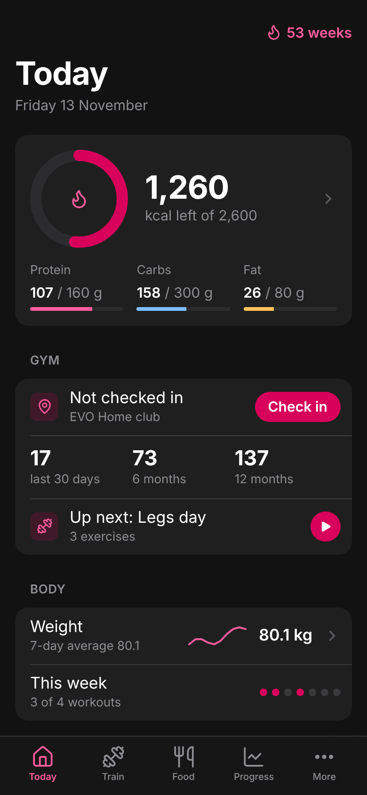
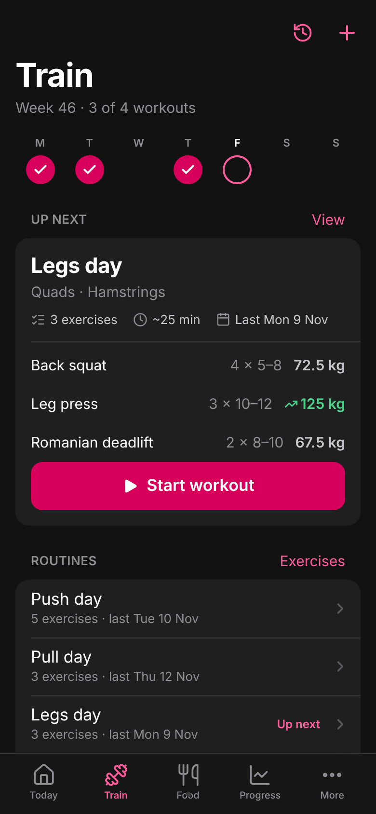
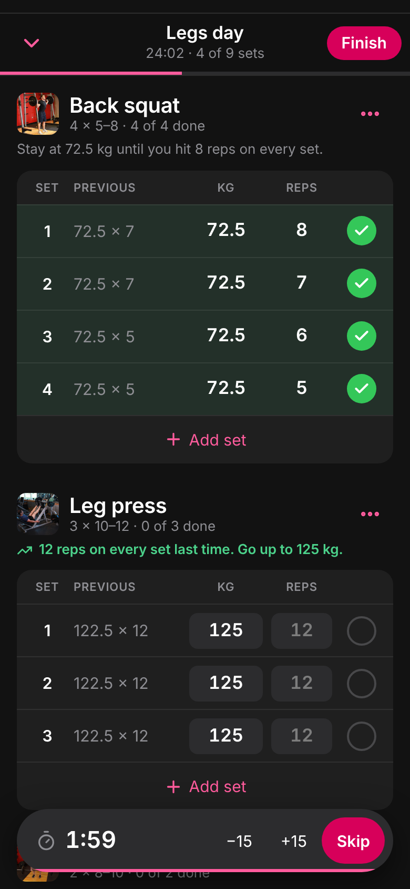
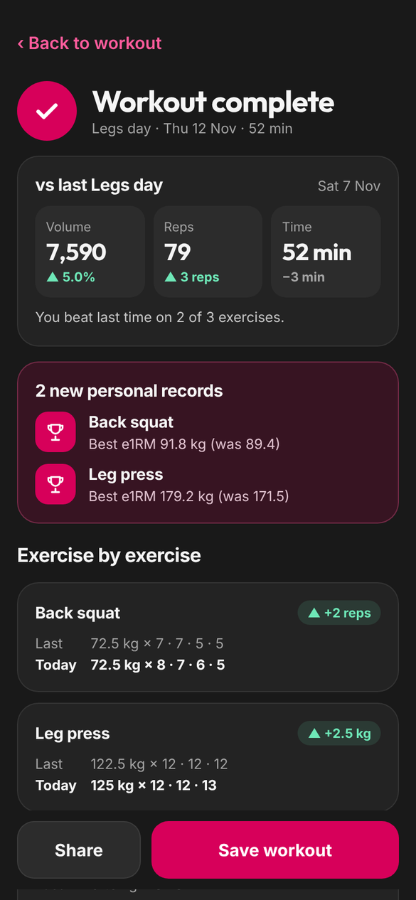
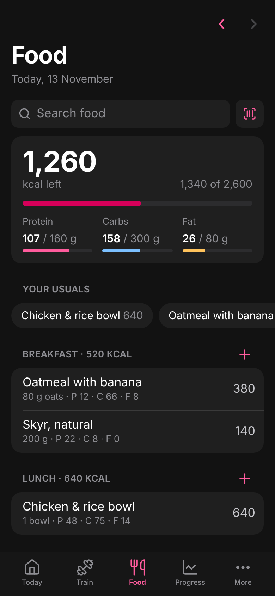
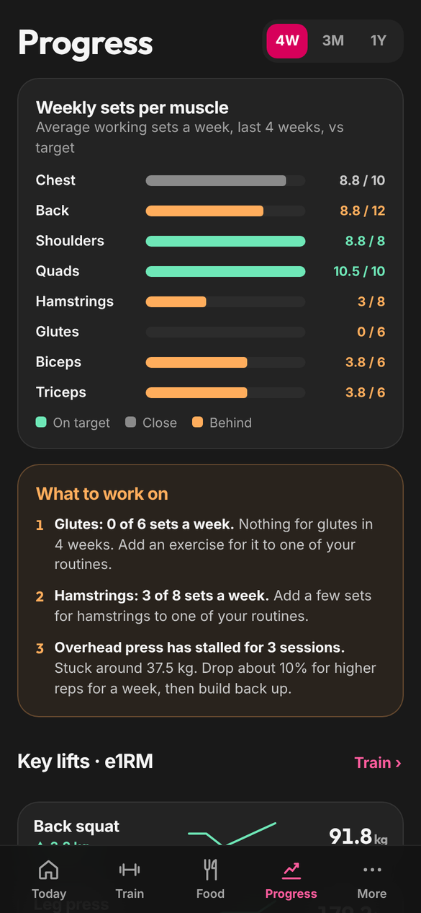

# EVO Stats

A personal gym companion for the iPhone: gym visits, workouts, food and body weight in one app. Add it to your home screen, and it checks you in automatically when you arrive at EVO.

<p align="center">
  
  
  
</p>
<p align="center">
  
  
  
</p>

## What it does

**Today**
- Whether you've been to the gym today, your visits this month and year, and your week streak
- Calories left, with protein, carbs and fat
- Today's workout from your weekly plan, or a rest day
- Your main EVO centre: open or closed, and how busy it is right now

**Train**
- A weekly plan, with Push / Pull / Legs ready to use. If you miss a day, the plan picks up where you left off, and every Monday starts a new week. You can skip a workout too
- Log one set at a time. Each set is filled in from last time, with a suggested weight when it's time to go up
- A rest timer between sets, and the workout is kept on your phone until you save it, so nothing is lost if you close the app
- When you finish: how it compared with last time, new personal records, and what to aim for next time
- About 750 exercises with photos, or add your own

**Food**
- Calories and macros per meal. Swipe a food left to delete it, or press and hold to move it to another meal
- Search products (Norwegian first), scan a barcode, or take a photo of your plate and let AI estimate each food. You check the grams before anything is added
- Show more nutrients: fibre, sugar, saturated fat and salt
- Steps from Apple Health can add the calories you burn to the day's goal
- First-time setup works out your calories from your body stats and goal (cut, maintain or bulk)

**Progress**
- A body map shaded by how much you train each muscle every week
- Lifts that have stalled and muscles that need more work
- Strength, body weight and gym visits over time

**More**
- All 92 EVO centres in Norway, nearest first, with live and hourly busyness
- Visit history, weight log and goals
- Shortcuts guides: check in automatically when you arrive at the gym, and sync weight and steps from Apple Health

Swipe left and right to move between tabs. New versions install by themselves the next time you open the app.

## How progression works

- **Double progression.** Stay at a weight until every set reaches the top of the rep range, then go up: 2.5 kg on barbells, 2 kg in the dumbbell range, 1 kg under 10 kg.
- **Stalled lifts.** If neither of your last two sessions beat the one before, the app suggests dropping about 10% and building back up.
- **Estimated 1-rep max.** The Epley formula, so 5 × 100 kg and 8 × 90 kg can be compared.
- **Weekly sets per muscle.** Working sets (not warm-ups) per week, compared with a target.

## How it's built

- **App:** React, TypeScript and Vite, added to the iPhone home screen and hosted on GitHub Pages
- **Data and sign-in:** Supabase (Postgres with row-level security, so you only ever see your own data)
- **Server functions:** live centre busyness and the food photo estimates run as Supabase Edge Functions, so no keys are in the app
- **iPhone Shortcuts:** log visits, weight and steps with a personal key you can replace at any time

## Try it

```bash
npm install
npm run dev
```

Open `http://localhost:5173/?demo` to try it with sample data. Nothing in the demo is saved.

---

Personal project. Not affiliated with or endorsed by EVO Fitness.

## Credits

- EVO centre list and coordinates: [evofitness.no](https://evofitness.no/sentre/)
- Exercise names and photos: [free-exercise-db](https://github.com/yuhonas/free-exercise-db) by yuhonas, public domain (The Unlicense)
- Live centre numbers: [EVO Visits](https://visits.evofitness.no/)
- Food photo estimates: Google Gemini
- Food data: [Open Food Facts](https://world.openfoodfacts.org), under the Open Database License
- Body map: [react-muscle-highlighter](https://github.com/soroojshehryar/react-muscle-highlighter), MIT
