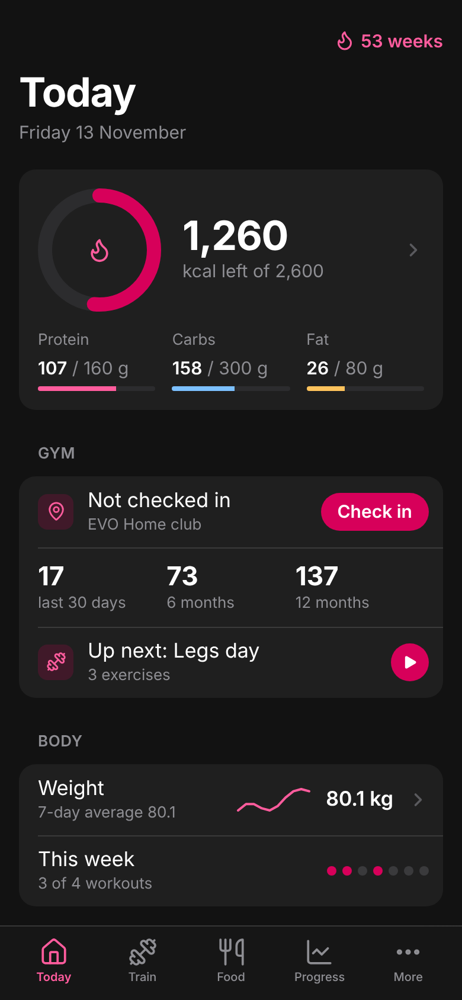
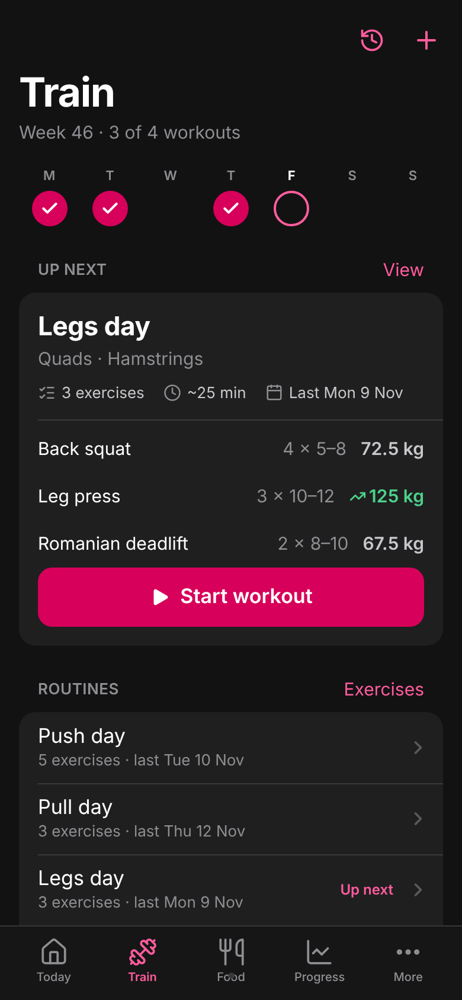
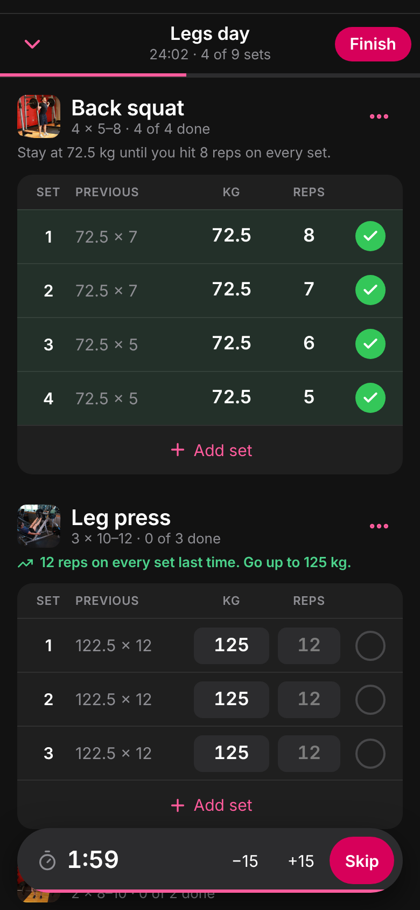
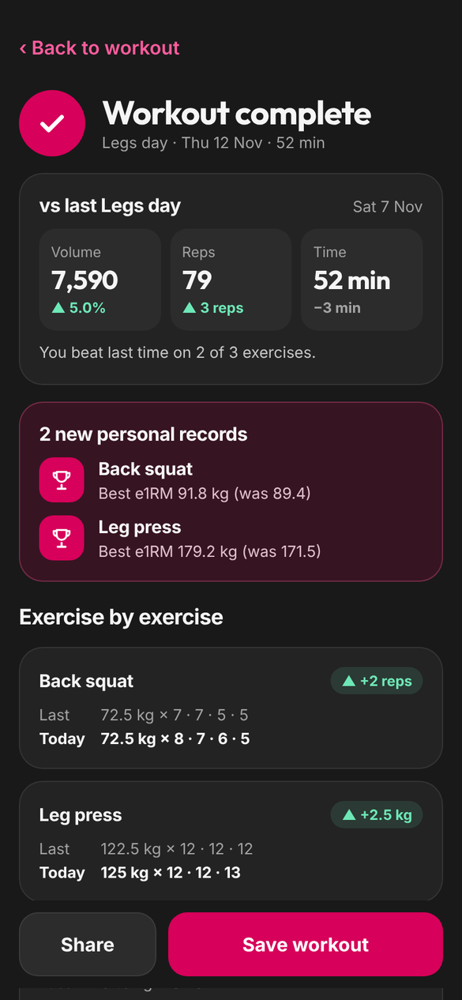
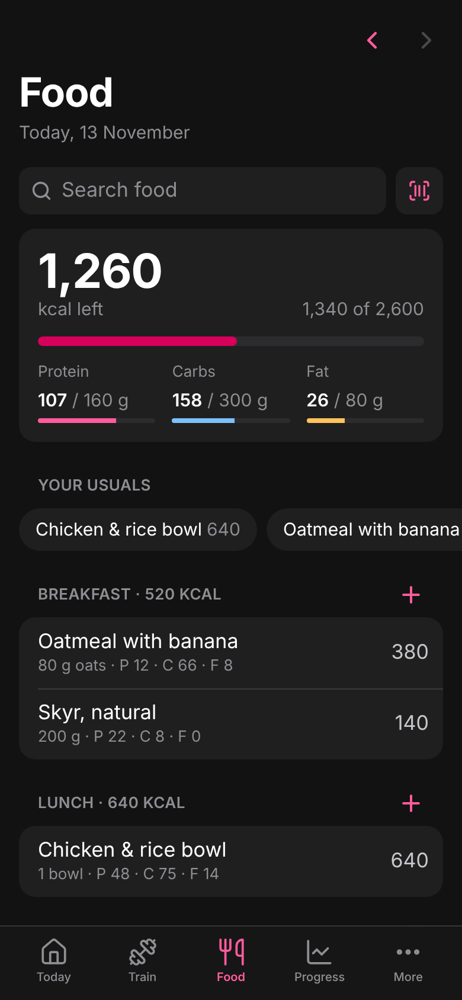
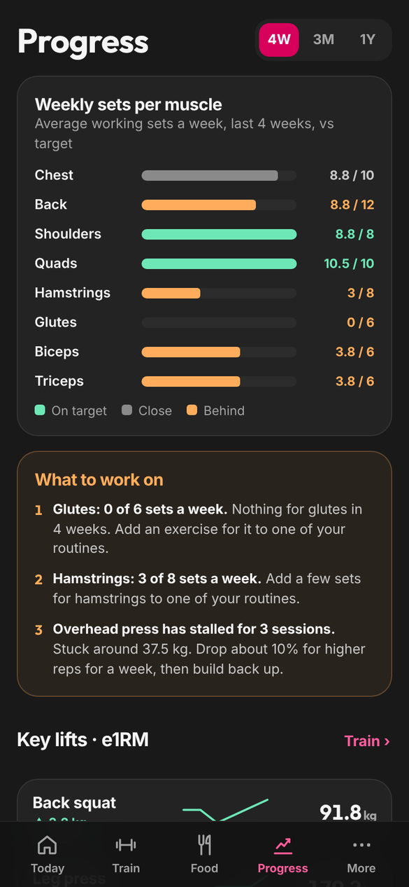

# EVO Stats

A personal gym companion for the iPhone: gym visits, workouts with progressive overload, calories and body weight in one app. It's a web app you add to your home screen, and iPhone Shortcuts check you in automatically when you arrive at the gym.

<p align="center">
  
  
  
</p>
<p align="center">
  
  
  
</p>

## Features

**Today**
- Checked in or not, plus visits in the last 30 days, 6 months and 12 months, and your week streak
- Calories left with protein, carbs and fat
- Today's workout, or the next one in your plan with a Begin button
- Body weight trend and gym days this week

**Train**
- A plan made of routines (for example Push / Pull / Legs), each with targets like 4 × 6–8
- **Begin** a routine. Every set shows what you lifted last time, with the suggested weight already filled in
- Tick sets as you go. A rest timer starts on each tick. You can mark warm-up sets, add or remove sets and exercises, and minimise the workout
- **Finish** to compare with the last time you did that routine: volume, reps, time, each exercise up or down, and new personal records
- A plan for next time, for example "Hit 8 reps on every set, then go up to 62.5 kg"
- The workout in progress is kept on the phone until you save it, so closing the app or losing signal at the gym loses nothing
- An exercise library of about 750 exercises with photos. Search, filter by muscle, pick several at once, or create your own

**Food**
- Calories and macros per meal: breakfast, lunch, dinner and snacks
- Your own food library with serving sizes, plus one-tap adds for the foods you log most
- Scan a barcode with the camera. Nutrition comes from Open Food Facts, you enter the grams, and the calories and macros are worked out from the per-100 g values. Products it doesn't know can be typed in from the label once, and after that a scan is instant
- Setup on first sign-in: from sex, age, height, weight, goal weight and activity it estimates your maintenance calories (Mifflin–St Jeor), then offers a mild, normal or aggressive cut or a lean bulk or bulk, with the weekly rate and weeks to your goal
- Daily goals for calories, protein, carbs and fat. Change the calories and the macros scale with them; change a macro and the calories follow

**Progress**
- A front and back body map shaded by your weekly working sets per muscle. Tap a muscle to focus on it
- Weekly working sets per muscle compared with a target
- What to work on: lagging muscles and lifts that have stalled
- Estimated 1-rep max trend for your main lifts, body weight, and visits per week

**EVO centres**
- All 92 EVO centres in Norway, nearest first when location is on, with search
- One tap to the centre in Google Maps, where Google shows live busyness and popular times, plus directions and your own usual training hours there
- Save a centre as your club for automatic check-ins

**Automatic check-ins**
- iPhone Shortcuts log a visit when you arrive at the gym or tap an NFC sticker
- A daily Shortcut syncs your weight from Apple Health
- Visits within 3 hours count once, so several triggers never double-count

**Accounts**
- Create an account, reset a forgotten password, choose whether to stay signed in, and delete your account with all its data

## How progression works

- **Double progression.** Stay at a weight until every set reaches the top of the rep range, then go up: 2.5 kg on barbells, 2 kg in the dumbbell range, 1 kg under 10 kg.
- **Stalled lifts.** If neither of your last two sessions beat the one before (no more weight, no better estimated 1-rep max, no extra reps at the same weight), the app suggests dropping about 10% and building back up.
- **Estimated 1-rep max.** Uses the Epley formula, so 5 × 100 kg and 8 × 90 kg can be compared on one scale.
- **Weekly sets per muscle.** Each exercise has a main muscle. Working sets (not warm-ups) are averaged per week and compared with a target.

## Tech stack

- **Frontend:** React 18, TypeScript, Vite, Lucide icons. Charts are hand-written SVG, with no chart library.
- **Barcode scanning:** the browser's BarcodeDetector where it exists, otherwise ZXing compiled to WebAssembly (`barcode-detector`), with the WebAssembly file served from this site
- **Body map:** `react-muscle-highlighter`, loaded only when you open Progress
- **Backend:** Supabase (Postgres, Auth, Row Level Security, RPC functions)
- **Hosting:** GitHub Pages, deployed by GitHub Actions on every push to `main`
- **Automation:** iPhone Shortcuts calling token-protected database functions

```
iPhone Shortcuts ── log_visit / log_weight (personal key) ──┐
                                                            ▼
Home-screen web app ── signed in, Row Level Security ──► Postgres (Supabase)
  (GitHub Pages)                                            ▲
GitHub Action ── keep-alive ping every 3 days ──────────────┘
```

## Security

- Every table has Row Level Security: you only ever read or change your own rows.
- Extra restrictive policies stop anyone from linking their data to another user's exercises, routines, workouts or foods.
- A workout and its sets are saved in one transaction (`save_workout`).
- Shortcuts don't sign in. They call two narrow functions that require a personal key, which you can rotate in Settings.
- Deleting an account removes the login and, through cascading deletes, all of that user's data.

## Project structure

```
src/
  screens/      Today, Train, ActiveWorkout, WorkoutSummary, Food, Progress, More, Clubs, Weight, Settings, Login
  components/   Charts and shared UI (sheets, pickers, rings, sparklines)
  lib/
    training.ts   progression tips, stall detection, comparisons, PRs, muscle volume
    draft.ts      the workout in progress, kept in localStorage
    stats.ts      visit counts, streaks, e1RM
    supabaseApi.ts / demoApi.ts   the real backend and an in-memory demo
supabase/schema.sql   tables, security policies and database functions
.github/workflows/    deploy to Pages, database keep-alive
```

## Run it locally

```bash
npm install
npm run dev
```

Open `http://localhost:5173/?demo` to try the app with eight weeks of sample data. Demo mode needs no backend, and nothing in it is saved.

---

Personal project. Not affiliated with or endorsed by EVO Fitness.

## Credits

- EVO centre list and coordinates: [evofitness.no](https://evofitness.no/sentre/)
- Exercise names and photos: [free-exercise-db](https://github.com/yuhonas/free-exercise-db) by yuhonas, public domain (The Unlicense)
- Food data: [Open Food Facts](https://world.openfoodfacts.org), under the Open Database License
- Body map: [react-muscle-highlighter](https://github.com/soroojshehryar/react-muscle-highlighter), MIT
